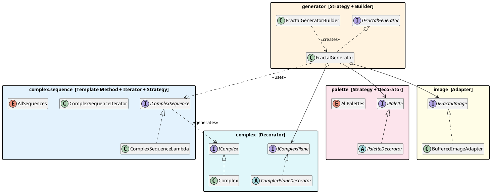
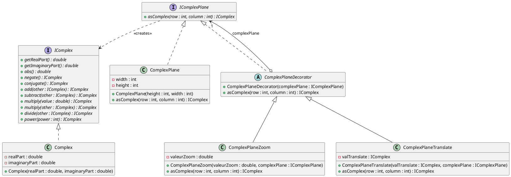
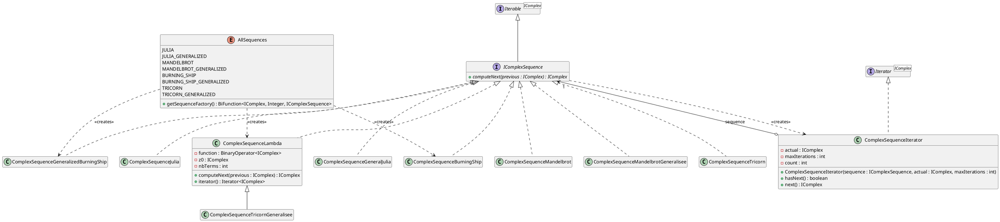
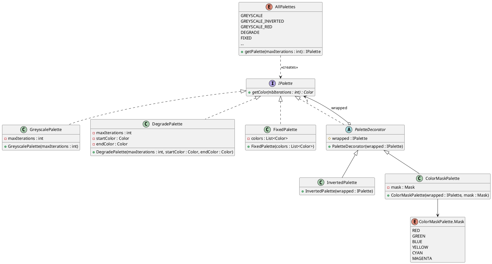
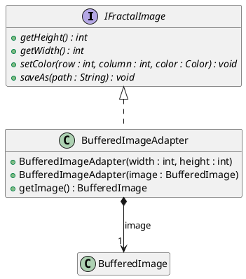
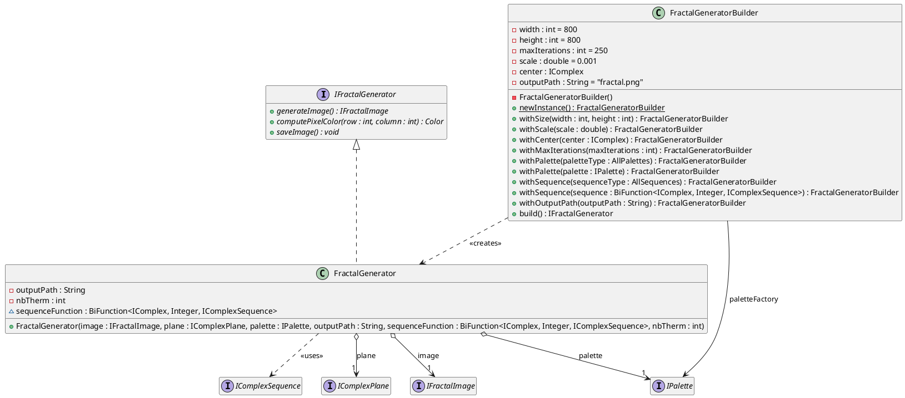

# FractaLens - A Fractal Generator Library Developed in Lens.

This project provides a *Java* library for generating fractal images.
It allows users to choose from a variety of complex sequences, including the
Julia set, Mandelbrot set, and other generalized sequences, to create
static or animated fractal images using different color palettes and
transformations.

## Build and run

The project uses *Java 25* and *Gradle* (through the provided wrapper).

```bash
./gradlew build      # compiles the library and runs the unit tests
./gradlew test       # runs the unit tests and produces the JaCoCo coverage report
./gradlew run        # runs the demonstration (generates generator1.png to generator4.png)
```

The coverage report is generated in `build/reports/jacoco/test/html/index.html`.

## Overview

The library is split into five packages.
Each package is built around one or two design patterns, summarized below.



### Complex numbers and complex plane

A pixel of the image is associated with a complex number by an `IComplexPlane`.
The default plane (`ComplexPlane`) centers the image on 0; it can then be
*decorated* to zoom on it (`ComplexPlaneZoom`) or to move its center
(`ComplexPlaneTranslate`).
Decorators can be stacked: the builder wraps a zoom inside a translation.

**Pattern: Decorator.** Each decorator implements `IComplexPlane`, holds the plane
it decorates, delegates `asComplex()` to it and transforms the result.
Adding a new transformation (e.g. a rotation of the plane) only requires a new
decorator, without modifying the existing classes.



### Complex sequences

A complex sequence is defined by its first term `z0` and by the way the next
term is computed from the previous one (`computeNext()`).
The generator only needs to *count* the terms of the sequence before it
diverges (modulus greater than 2) or reaches the maximum number of terms.

**Pattern: Template Method + Iterator.** `ComplexSequenceIterator` contains the
common iteration algorithm (`hasNext()` checks the divergence criterion,
`next()` calls `computeNext()`), whereas each sequence only provides the
variable step `computeNext()`.
Since `IComplexSequence` extends `Iterable<IComplex>`, any sequence can be
traversed with a `for-each` loop.

**Pattern: Strategy.** `ComplexSequenceLambda` receives the formula of the
sequence as a `BinaryOperator<IComplex>`, so a new sequence can be defined with
a lambda expression instead of a new class.
The `AllSequences` enumeration gathers the predefined sequences and gives, for
each of them, a factory `BiFunction<IComplex, Integer, IComplexSequence>`
(pixel → sequence) that can be passed to the builder.



### Color palettes

A palette associates a number of iterations with a color.

**Pattern: Strategy.** `GreyscalePalette`, `DegradePalette` (gradient between two
colors) and `FixedPalette` (one color per number of iterations) are
interchangeable implementations of `IPalette`: the generator does not know
which one it uses.

**Pattern: Decorator.** `PaletteDecorator` wraps another palette and modifies its
colors: `InvertedPalette` inverts them, `ColorMaskPalette` only keeps some of
their components (red, green, blue, yellow, cyan or magenta).
Decorators can be combined, e.g. a masked inverted gradient.

The `AllPalettes` enumeration lists every combination
*base palette × decorators* (42 constants), and creates the corresponding
palette from the maximum number of iterations.



### Images

**Pattern: Adapter.** The library manipulates images through its own interface
`IFractalImage`. `BufferedImageAdapter` adapts the `BufferedImage` class of the
Java standard library to this interface, so that the rest of the code does not
depend on AWT. The output format (PNG by default) is deduced from the extension
of the file.



### Fractal generation and configuration

`FractalGenerator` computes the color of each pixel: it converts the pixel into
a complex number with the plane, builds the sequence of this pixel, counts its
terms and asks the palette for the matching color.

**Pattern: Strategy.** The generator is configured with interchangeable
objects: the plane, the palette, the image and the function creating the
sequence of each pixel.

**Pattern: Builder.** `FractalGeneratorBuilder` provides a default value for
every parameter and fluent `withXxx()` methods to change them, checking their
validity. `build()` assembles the decorated plane, the image and the generator.



## Feature list

| Features                                               | Design Pattern(s)          | Status      | Author(s)                       |
|--------------------------------------------------------|----------------------------|-------------|---------------------------------|
| Complex number                                         |                            | Done        | TODO                            |
| Default complex plane                                  | Decorator                  | Done        | Thibault Breguet                |
| Scaled complex plane                                   | Decorator                  | Done        | Thibault Breguet                |
| Translated complex plane                               | Decorator                  | Done        | Théo Brureau                    |
| Sequence of complex numbers                            | Template method            | Done        | TODO                            |
| Iterator over a sequence of complex numbers            | Iterator                   | Done        | TODO                            |
| Julia sequence                                         | Strategy                   | Done        | Théo Brureau                    |
| Mandelbrot sequence                                    | Strategy                   | Done        | TODO                            |
| Multijulia sequence                                    | Strategy                   | Done        | Thibault Breguet                |
| Multibrot sequence                                     | Strategy                   | Done        | TODO                            |
| Burning Ship sequence (and generalized version)        | Strategy                   | Done        | Théo Brureau                    |
| Tricorn sequence (and generalized version)             | Strategy                   | Done        | Marie Tiers                     |
| Generic sequences (defined by a lambda expression)     | Strategy                   | Done        | TODO                            |
| Enumeration of the available sequences                 | Strategy                   | Done        | Thibault Breguet                |
| Color palette                                          | Strategy                   | Done        | Marie Tiers                     |
| Grey scale palette                                     | Strategy                   | Done        | Marie Tiers                     |
| Red/Green/Blue/... scale palette                       | Decorator                  | Done        | TODO                            |
| Inverted color palette                                 | Decorator                  | Done        | TODO                            |
| Gradient-based color palette                           | Strategy                   | Done        | Théo Brureau                    |
| Predefined color palette                               | Strategy                   | Done        | Théo Brureau                    |
| Enumeration of the available palettes                  | Strategy + Decorator       | Done        | Marie Tiers                     |
| `BufferedImage` used as an `IFractalImage`             | Adapter                    | Done        | Théo Brureau                    |
| Static image generation                                | Strategy                   | Done        | TODO                            |
| Configuration of the fractal generator                 | Strategy + Builder         | Done        | Théo Brureau                    |
| Composite of fractal generators (animated GIF)         | Composite                  | In progress | TODO                            |
| Scale-based animated image generation                  | Composite + Builder        | In progress | TODO                            |
| Rotation-based animated image generation               | Composite + Builder        | In progress | Marie Tiers                     |
| Command-line interface                                 | Abstract factory + Builder | To do       |                                 |

## Team

This project has been developed by:

- Brureau Théo
- Pesson Joan
- Breguet Thibault
- Tiers Marie
